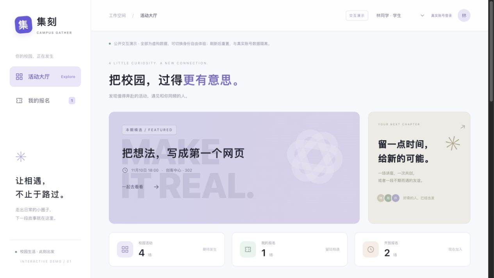

# 集刻 · Campus Gather

一个校园活动报名与签到产品：注册用户发现和报名活动，也能发起自己的活动、管理名单并核验到场。重点展示角色权限、名额竞争和事务一致性。

[免登录在线演示](https://our-little-space-d9evhay4626495b-1526450049.tcloudbaseapp.com/campus/demo/) · [三分钟体验](docs/SHOWCASE.md) · [架构说明](docs/ARCHITECTURE.md) · [验证与限制](docs/TESTING.md)



[手机布局](docs/screenshots/showcase-mobile.png) · [组织者名单演示](docs/screenshots/showcase-online-roster.png)

## 先体验，再看实现

在线演示无需账号。右上角切换模拟学生和组织者，体验报名、取消、发布、名单筛选、签到及 CSV 导出；刷新恢复四场初始活动。数据只在当前页面内存中，不与真实云端账号或数据库互通。

云端测试站与公开演示是不同入口。共享测试环境可能因额度、网络或维护暂停，当前环境有效期记录至 **2027 年 5 月 6 日**，不承诺持续在线、自动续期或永久免费。平台测试域名可能显示访问提示。本机运行不依赖该测试站。

## 本机启动

需要 Node.js **22.18+（22.x）** 和 npm。安装了 nvm 可先执行 `nvm use`。

```sh
npm ci
npm run dev
```

打开 [本机活动大厅](http://127.0.0.1:3010/) 或 [免登录交互演示](http://127.0.0.1:3010/demo/)。不需要 API 密钥、云账号或付费服务。生产构建使用 `npm run build`，再运行 `npm start`。

## 运行方式

| 模式 | 入口 | 身份与数据 |
| --- | --- | --- |
| 公开交互演示 | `/demo/`，线上 `/campus/demo/` | 虚构身份，页面内存；刷新重置 |
| 本机模拟 | 默认 `/`，3010 端口 | 预设学生/组织者；PGlite 保存到 `.data/campus` |
| 本机账号 | 构建后 `npm run start:accounts`，3011 端口 | 独立账号与 Cookie 会话；`.data/accounts` |
| CloudBase | 自建环境，静态托管 `/campus/` | 平台认证、PostgreSQL RLS 与受保护 RPC |

本机模拟身份不是登录权限机制；账号模式忽略模拟身份请求头。所有有效账号都能发布自己的活动，名单与签到只对发布者开放；历史角色字段保留兼容，不决定发布资格。本机账号版尚不适合直接面向公众开放。自行部署见 [部署说明](docs/SELF_HOSTING.md)。

## 已实现

- 活动大厅、分类与关键词搜索、详情、截止与剩余名额状态。
- 用户报名、重复报名拒绝、取消释放名额及本人报名列表。
- 注册用户发布活动、仅管理本人活动、名单搜索与签到状态筛选。
- 到场确认、幂等签到、已签到禁止取消；筛选名单导出 CSV。
- 发布者可说明原因取消活动，保留报名历史并停止新报名/签到；云端可见页面每 30 秒刷新。
- 云端每个账号滚动 24 小时最多发布 5 场，数据库串行检查限额。
- 桌面与手机布局、弹窗键盘操作、加载/空/失败反馈；名单刷新失败时隐藏旧记录并禁用导出。

## 值得核查的工程实现

| 问题 | 实现 | 代码与证据 |
| --- | --- | --- |
| 两个人抢最后一个名额会超额吗？ | 云端 RPC 先锁活动，再计数与写入；本机单独采用进程内队列 | [SQL 迁移](cloudbase/migrations/202611080001_campus.sql)、[真实 PostgreSQL 多连接测试](tests/postgres-concurrency.mjs) |
| 如何阻止用户读取或签到别人的活动名单？ | 服务端查有效身份及活动所有者，三表 RLS，禁止客户端直接写表 | [SQL 权限测试](tests/cloudbase.test.mjs)、[账号策略测试](tests/account-enrollment-policy.test.mjs) |
| 重复签到或取消和签到同时发生怎么办？ | 统一锁顺序、首次时间保留与状态约束 | [并发验收与负向对照](docs/POSTGRES_CONCURRENCY.md) |
| 账号版能否伪造演示身份？ | HttpOnly 会话、服务端摘要存储，账号模式忽略身份选择请求头 | [认证实现](src/lib/auth.ts)、[HTTP 集成](tests/http-auth.mjs) |
| 演示会误写真实数据吗？ | 显式数据通道选择，虚构模型不使用网络或持久存储 | [展示模型](src/lib/showcase.ts)、[隔离测试](tests/showcase.test.ts) |
| 导出表格是否暴露内部 ID 或执行公式？ | 仅导出当前筛选名单，CSV 转义与公式前缀防护 | [名单与导出](src/lib/roster.ts)、[测试](tests/roster.test.ts) |

技术栈：Next.js App Router、React、TypeScript、Tailwind CSS；本机 PGlite；云端 CloudBase 认证、PostgreSQL 与静态托管。活动封面由 CSS 绘制，无外部字体、图片服务或付费 AI API。

## 测试

```sh
npm test
npm run test:cloudbase
npm run build
npm run typecheck
```

本机已验证 43 项逻辑测试、3 组 SQL 权限场景及账号 HTTP 集成。Docker 启动后运行：

```sh
docker pull postgres:16-alpine
npm run test:postgres
```

七项真实 PostgreSQL 多连接场景通过，包含移除锁的负向对照；不能据此承诺生产吞吐量。HTTP、静态产物及匿名云端检查的复现方式见 [验证说明](docs/TESTING.md)。仓库附 GitHub Actions 工作流，使用虚构数据，无需云密钥，也不会自动部署。

## 当前边界与后续

当前正在从 v0.1.0 演示版升级为 **真实产品首版**，见 [上线验证进度](docs/PRODUCT_READINESS.md)。v0.2.0-rc.1 的新迁移与前端已部署，35 个线上文件与本地产物哈希一致。真实云端当前账号已验证发布、报名/取消和整场取消后刷新保留；新邮箱注册、找回密码仍需账号本人验收；两个真实账号跨浏览器的完整报名至签到闭环、多设备及长期负载仍待验收。

当前采用注册用户自助发布，无需组织者审核。尚未实现分页、现场身份核验与签到时段；本机账号没有完整密码恢复、注销或分布式限流。不要把本机演示直接当作公开运营平台，也不要将本机并发测试包装成生产性能指标。

下一步优先完成真实新邮箱注册与双账号联合验收，再完善完整账号生命周期与分页。详细取舍见 [架构说明](docs/ARCHITECTURE.md)。

## 开发方式与个人参与

作者提出作品集目标、国内访问与成本约束，参与试用反馈和云端授权。代码实现、调试、验证与文档整理使用 Codex 辅助。该项目用于持续学习；个人能力应结合对关键实现和测试的实际讲解判断，不等于完全独立手写。可结合 [项目讲解指南](docs/PORTFOLIO.md) 阅读和复现。

## 许可与参与

代码采用 [MIT License](LICENSE)。欢迎 Issue 和 Pull Request，先读 [贡献说明](CONTRIBUTING.md) 与 [安全范围](SECURITY.md)。不要提交环境文件、密码、验证码、真实报名资料或本机数据库。
